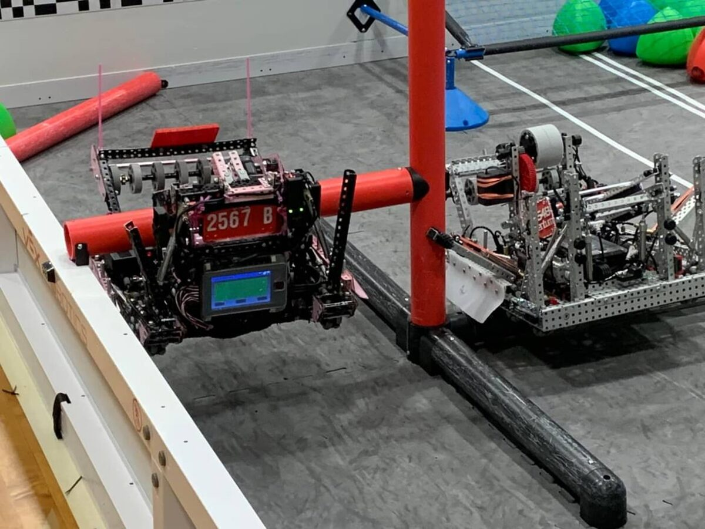
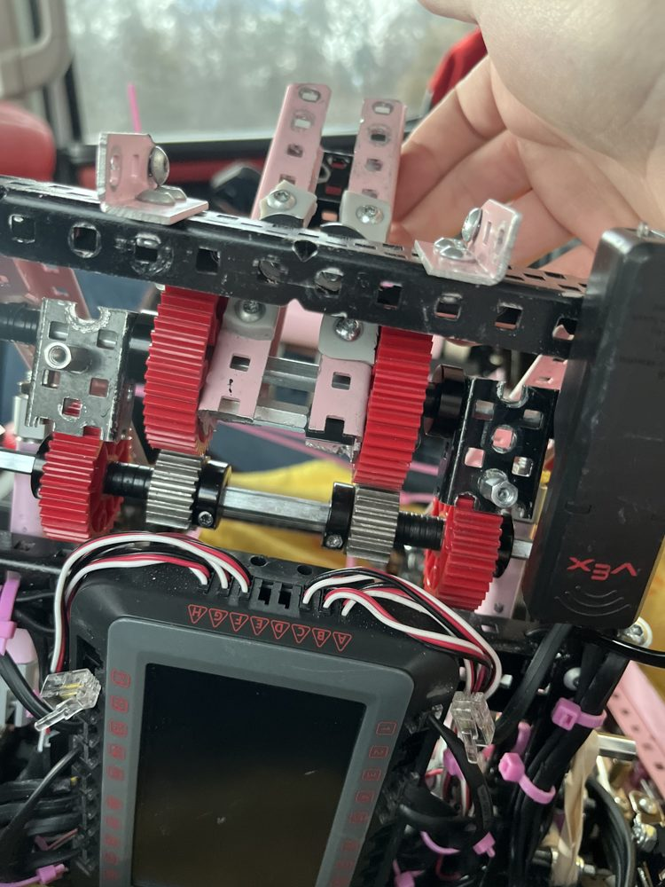

# VEX Robotics 2567B

Competition code for VEX V5 team **2567B**, written in C++ on
[PROS](https://pros.cs.purdue.edu/), for the *Over Under* season: wings, a
catapult, and a climb.

<p align="center">
  
  
</p>

This is team code. The drivetrain control comes from two open-source
libraries, credited below. What we wrote on top of them is the robot
configuration, the PID tuning, the driver controls, and the autonomous
routines.

## What's here

| Folder | What it is |
|---|---|
| [`worlds-ez-template/`](worlds-ez-template/) | The final competition program, built on EZ-Template. It has a selectable set of autonomous routines (far side, win point) and driver control for the intake, catapult (with a rotation sensor), pneumatic wings, gripper and climb. |
| [`lemlib/`](lemlib/) | A port to LemLib with IMU-based odometry and **pure pursuit** path following. Paths were drawn as waypoint files (`static/*.txt`) and embedded at build time with `ASSET()`. |
| [`lemlib-first-port/`](lemlib-first-port/) | The first LemLib attempt: motor groups, drivetrain geometry, and lateral and angular PD controllers. |

## Engineering notes

- **Two sets of tuned PID constants.** `worlds-ez-template/src/autons.cpp` has
  `default_constants()` for precise moves, and `plowingConstants()` with
  higher gains and full slew power, for pushing game pieces.
- **Exit conditions are tuned per move type** (drive, turn, swing) so a
  routine moves on as soon as the robot settles, instead of waiting on
  fixed timeouts. That trade-off between consistency and time is what fits
  a routine into the 15-second autonomous period.
- **The move to odometry.** EZ-Template drives relative distances and
  headings. LemLib tracks absolute field position, which is what makes
  following a pre-planned curved path possible.

## Building

The libraries themselves aren't committed. Restore them with the PROS CLI,
then build and upload:

```bash
cd worlds-ez-template
pros c apply EZ-Template@2.1.2   # restores firmware/ and include/EZ-Template
pros make
pros upload
```

For `lemlib/`, run `pros c apply LemLib@0.5.0-rc.5` instead. The templates
each project expects are listed in its `project.pros`.

## Credits

- [PROS](https://pros.cs.purdue.edu/), the V5 kernel and toolchain from
  Purdue ACM SIGBots.
- [EZ-Template](https://github.com/EZ-Robotics/EZ-Template), the drive PID,
  slew and autonomous selector.
- [LemLib](https://github.com/LemLib/LemLib), odometry and pure pursuit.
